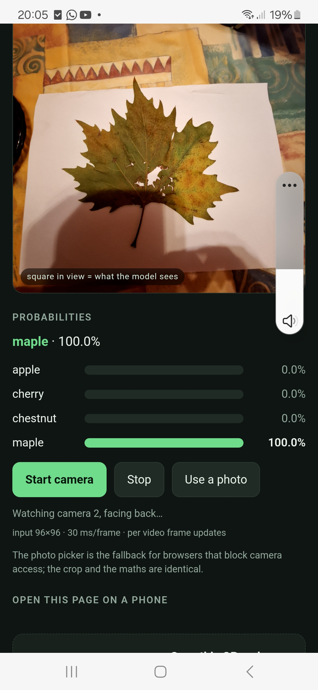

1.
Application works on mobile as intended. Proof 

2.
The results are: "apple": 0.9991209796102658,
  "cherry": 0.0008336547403291935,
  "chestnut": 0.000043643820398252224,
  "maple": 0.0000017218290068847934
which is the same as in the check_expected.json

3.
In `index.html`, the function `preprocessFrom(source, srcW, srcH)` takes the central square of the frame (`side = Math.min(srcW, srcH)`, `sx = (srcW - side) / 2`, `sy = (srcH - side) / 2`) and resizes it to `96 × 96` on an off-screen canvas via `workCtx.drawImage(source, sx, sy, side, side, 0, 0, S, S)`. Inside the pixel loop over `workCtx.getImageData(0, 0, S, S)`, each RGB byte is divided by `255` and standardized using `(data[i] / 255 - mean[c]) / std[c]` with `mean = [0.485, 0.456, 0.406]` and `std = [0.229, 0.224, 0.225]`. The channels are written in RGB order into three contiguous planar arrays (`R` at `0..plane-1`, `G` at `plane..2*plane-1`, `B` at `2*plane..3*plane-1`, ignoring Alpha) and wrapped by `classify()` into a channel-first `NCHW` tensor via `new ort.Tensor('float32', data, [1, 3, 96, 96])` before applying `softmax()` to the output logits. Yes, this preprocessing matches `model_info.json` and the PyTorch validation transform in the notebook.

4.
No image data is ever sent anywhere: camera frames are processed on a local in-memory `<canvas>`, uploaded photos use local `URL.createObjectURL(file)`, the QR code is drawn locally via an inline script, and inference runs entirely on the device. The page loads `https://cdn.jsdelivr.net/npm/onnxruntime-web@1.22.0/dist/ort.min.js` (and its WebAssembly binary from the same CDN) to run the ONNX inference engine in the browser. It also fetches `./model_info.json` and `./leaf_model.onnx` from the same GitHub Pages origin to load the class names, normalization constants, and trained MobileNetV3 weights. Only when opened with `?selftest=1` does it additionally fetch `./check_image.jpg` and `./check_expected.json` from the same origin for local verification.